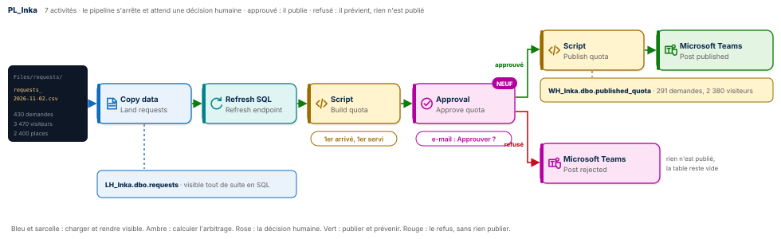
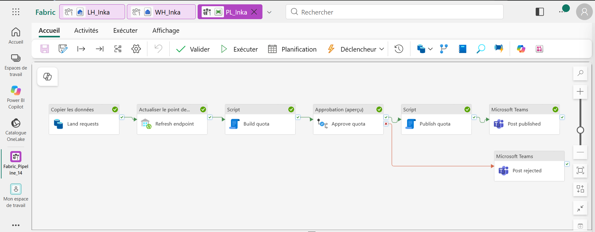
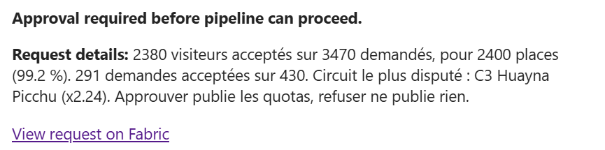
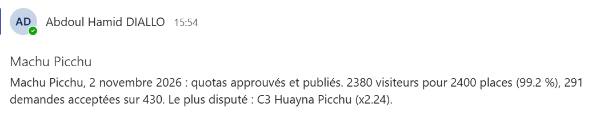
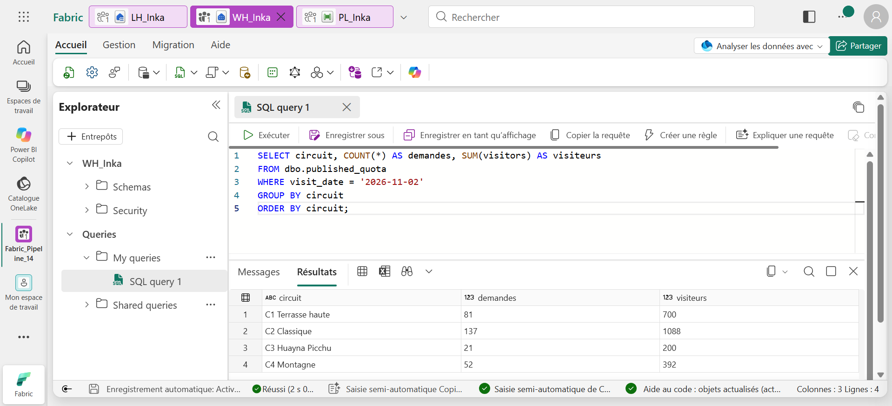
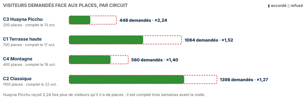

# 🏔️ Fabric Pipeline Express 14 : un humain dans la boucle




Un pipeline Microsoft Fabric Data Factory qui attribue les places de la visite de Machu Picchu du 2 novembre 2026. Les agences ont demandé 3 470 places pour 2 400 disponibles, réparties sur quatre circuits. Le pipeline charge les demandes, arbitre en « premier arrivé, premier servi », puis **s'arrête et demande l'accord d'un humain par e-mail**. Approuvé : il publie les quotas dans l'entrepôt et l'annonce dans Teams. Refusé : rien n'est publié, et Teams le dit. La décision humaine devient une étape du pipeline, tracée dans son historique.

**Guide PDF de 7 pages inclus** : [`Pipeline_Fabric_Guide_14_public.pdf`](Pipeline_Fabric_Guide_14_public.pdf). Chaque écran, chaque réglage, chaque expression, et les chiffres à retrouver à l'unité près. Les valeurs à copier sont dans [`data/expressions.txt`](data/expressions.txt) et les requêtes commentées dans [`sql/`](sql).

## 📸 Aperçu

`PL_Inka` après une exécution approuvée : le chemin vert de l'approbation jusqu'à Teams, et le chemin rouge du refus, prêt à servir.



L'e-mail d'approbation reçu pendant l'exécution : les chiffres de l'arbitrage, et le lien pour décider dans Fabric.



Le message publié dans Microsoft Teams après l'approbation.



La requête de contrôle dans l'entrepôt : les demandes publiées, circuit par circuit.



## 🎯 Résultats clés

| Indicateur | Valeur |
|---|---|
| Activités | 7 (Copy data, Refresh SQL analytics endpoint, Script, Approval, Script, Microsoft Teams × 2) |
| Nouveautés | Activité Approval (décision humaine par e-mail), deux chemins selon la réponse, arbitrage « premier arrivé, premier servi » par somme cumulée, publication rejouable sans doublon |
| Demandes | 430 demandes d'agences, 3 470 visiteurs |
| Places | 2 400 sur quatre circuits |
| Attribution | 2 380 visiteurs, 291 demandes acceptées, 99,2 % de remplissage |
| Demandes refusées | 139, faute de place |
| Circuit le plus disputé | C3 Huayna Picchu, 2,24 fois plus de demandes que de places |
| Complet le plus tôt | Huayna Picchu, le 13 octobre, trois semaines avant la visite |

## 💼 Impact métier

Certaines décisions ne doivent pas être prises par une machine seule. Publier des quotas de visite engage le site, les agences et les voyageurs : une erreur de calcul publiée est une erreur que des centaines de personnes subissent. Ce pipeline garde ce qui se calcule (l'arbitrage, les chiffres, la publication) et laisse à un responsable ce qui se décide. Le responsable reçoit un e-mail avec les chiffres utiles, il approuve ou refuse, et l'historique du pipeline garde la trace de qui a décidé et quand. C'est un contrôle à quatre yeux, sans application à développer.

## 📝 Résumé

`PL_Inka` copie le CSV des demandes dans la table `requests` du lakehouse `LH_Inka`, puis rafraîchit le point de terminaison SQL pour que la table soit visible tout de suite. Le Script `Build quota`, sur l'entrepôt `WH_Inka`, applique l'arbitrage et renvoie une seule ligne de chiffres. L'activité `Approve quota` envoie ces chiffres par e-mail et met le pipeline en pause. Si la demande est approuvée, la flèche verte mène à `Publish quota`, qui écrit les 291 demandes acceptées dans `published_quota`, puis à `Post published` dans Teams. Si elle est refusée, ou si personne ne répond dans l'heure, la flèche rouge mène à `Post rejected`, et rien n'est publié.

## 🔁 Pipeline

| Activité | Type | Rôle |
|---|---|---|
| `Land requests` | Copy data | Le CSV des demandes vers la table `requests`, action Remplacer |
| `Refresh endpoint` | Refresh SQL analytics endpoint | Rend la table visible en SQL sans attente |
| `Build quota` | Script | L'arbitrage en une requête : `resultSets[0]` porte tous les chiffres |
| `Approve quota` | Approval | E-mail de demande d'approbation, pause jusqu'à la réponse, délai d'une heure |
| `Publish quota` | Script | Si approuvé : écrit les demandes acceptées dans `published_quota` |
| `Post published` | Microsoft Teams | Si approuvé : annonce la publication |
| `Post rejected` | Microsoft Teams | Si refusé : annonce que rien n'a été publié |

## 🧠 Les quatre idées du projet

**Un humain dans la boucle.** L'activité Approval transforme une décision en étape du pipeline. Le pipeline calcule, présente, puis attend. Il ne publie rien tant qu'un responsable n'a pas dit oui.

**Deux chemins, une décision.** La flèche verte et la flèche rouge ne signalent plus une erreur technique, mais une réponse. Approuvé : publication. Refusé ou sans réponse : aucun effet, seulement un message.

**L'arbitrage en une ligne de SQL.** `SUM(v) OVER (PARTITION BY circuit ORDER BY t)` additionne les visiteurs dans l'ordre d'arrivée. Une demande est acceptée tant que ce total tient dans la capacité du circuit. Pas de boucle, pas de notebook.

**Une publication rejouable.** `Publish quota` crée la table au premier passage, efface la date, puis réécrit. Approuver deux fois ne double jamais les quotas.

## 🚦 Le pipeline en une image

| Étape | Au bureau des réservations | Dans Fabric |
|---|---|---|
| 1 | Les demandes des agences arrivent | CSV dans `Files/requests` |
| 2 | Elles sont saisies dans le registre | Copy data, puis Refresh SQL endpoint |
| 3 | Le commis attribue les places dans l'ordre d'arrivée | Script `Build quota` |
| 4 | Le directeur reçoit la proposition et signe, ou non | Approval |
| 5 | Signé : les quotas sont affichés et annoncés | Script `Publish quota`, puis Teams |
| 6 | Refusé : rien n'est affiché, l'équipe est prévenue | Teams |

## 🧬 Traçabilité

```
LH_Inka / Files / requests / requests_2026-11-02.csv     430 demandes, 3 470 visiteurs
                       │  Copy data Land requests (Remplacer)
                       ▼
LH_Inka.dbo.requests   request_id · agency · origin_country · circuit · visitors · requested_at
                       │  Refresh SQL analytics endpoint Refresh endpoint
                       ▼
Script Build quota sur WH_Inka
   resultSets[0]  requests 430 · accepted 291 · requested 3470 · granted 2380 · capacity 2400 · fill_pct 99.2 · hottest C3 Huayna Picchu · 2.24
                       │  Approval Approve quota (e-mail, délai 1 h)
          ┌────────────┴────────────┐
     approuvé                   refusé ou sans réponse
          ▼                          ▼
Script Publish quota           Microsoft Teams Post rejected
WH_Inka.dbo.published_quota    « quotas refusés, rien n'a été publié »
291 demandes, 2 380 visiteurs
          ▼
Microsoft Teams Post published
```

## 🏗️ Architecture

| Objet Fabric | Type | Rôle |
|---|---|---|
| `LH_Inka` | Lakehouse | Reçoit le CSV dans `Files/requests`, porte la table `requests` |
| `CN_Lakehouse` | Connexion Lakehouse | Compte d'organisation, utilisée par le rafraîchissement du point de terminaison |
| `WH_Inka` | Entrepôt | Exécute les deux Scripts, porte `published_quota` |
| Connexion Outlook | Office 365 Outlook | Envoie l'e-mail de l'activité Approval |
| `PL_Inka` | Pipeline | Orchestre le chargement, l'arbitrage, la décision et ses deux suites |

Le cœur de l'arbitrage, dans `Build quota` et `Publish quota` :

```sql
k AS (SELECT r.circuit, r.v, c.cap,
             SUM(r.v) OVER (PARTITION BY r.circuit ORDER BY r.t, r.id ROWS UNBOUNDED PRECEDING) AS run
      FROM r JOIN c ON c.circuit = r.circuit)
-- une demande est acceptée si run <= cap
```

Dès qu'une demande ferait déborder son circuit, elle et toutes les suivantes de ce circuit sont refusées : c'est la règle « premier arrivé, premier servi », appliquée sans exception.

## 📊 Résultat final



| Circuit | Places | Demandés | Accordés | Demandes publiées | Ratio | Complet le |
|---|---|---|---|---|---|---|
| **C3 Huayna Picchu** | 200 | 448 | 200 | 21 | **×2,24** | 13 octobre |
| C1 Terrasse haute | 700 | 1 064 | 700 | 81 | ×1,52 | 17 octobre |
| C4 Montagne | 400 | 560 | 392 | 52 | ×1,40 | 19 octobre |
| C2 Classique | 1 100 | 1 398 | 1 088 | 137 | ×1,27 | 22 octobre |
| **Total** | **2 400** | **3 470** | **2 380** | **291** | | |

## 📦 Jeu de données

```
data/
├── requests/
│   └── requests_2026-11-02.csv    430 demandes d'agences pour la visite du 2 novembre 2026
└── expressions.txt                toutes les valeurs du guide, prêtes à copier
```

Chaque demande porte `request_id`, `agency`, `origin_country` (le pays des voyageurs), `circuit`, `visitors` (taille du groupe) et `requested_at` (date et heure de la demande). Agences, demandes et capacités sont fictives, fixées pour l'exercice et reproductibles avec [`tools/generate_dataset.py`](tools/generate_dataset.py) ; [`tools/expected_results.py`](tools/expected_results.py) recalcule l'arbitrage attendu.

## 🚀 Reproduire l'exercice

1. Créer un lakehouse `LH_Inka`, un dossier `Files/requests`, y déposer le CSV. Créer un entrepôt `WH_Inka`.
2. Créer `PL_Inka` : Copy data `Land requests` vers la table `requests`, Refresh SQL analytics endpoint `Refresh endpoint`, Script `Build quota` avec [`sql/01_build_quota.sql`](sql/01_build_quota.sql).
3. Ajouter Approval `Approve quota` : type Outlook 365, votre adresse en approbateur, les chiffres de `Build quota` en description, délai `0.01:00:00`.
4. Flèche verte : Script `Publish quota` (type Non-requête) avec [`sql/02_publish_quota.sql`](sql/02_publish_quota.sql), puis Teams `Post published`. Flèche rouge : Teams `Post rejected`.
5. Exécuter et approuver : 291 demandes publiées. Exécuter et refuser : rien n'est publié, Teams le dit.

## 📂 Structure du dépôt

```
fabric-pipeline-express-14/
├── README.md
├── Pipeline_Fabric_Guide_14_public.pdf    le guide de 7 pages
├── data/
│   ├── requests/                          les demandes des agences
│   └── expressions.txt                    toutes les valeurs à copier
├── sql/
│   ├── 01_build_quota.sql                 l'arbitrage, une ligne de chiffres
│   ├── 02_publish_quota.sql               la publication, rejouable
│   └── 03_controle.sql                    les demandes publiées par circuit
├── tools/
│   ├── generate_dataset.py                régénère le CSV
│   └── expected_results.py                recalcule l'arbitrage attendu
└── images/
    ├── pipeline_diagram.svg               le schéma du pipeline
    ├── demand_by_circuit.svg              la demande face aux places
    ├── pipeline_run.png                   PL_Inka après une exécution approuvée
    ├── approval_email.png                 l'e-mail de demande d'approbation
    ├── teams_published.png                l'annonce dans Microsoft Teams
    └── controle_sql.png                   la requête de contrôle
```

## 🧰 Stack technique

Microsoft Fabric Data Factory · Approval (Outlook 365) · Copy data · Refresh SQL analytics endpoint · Script à résultat et Script sans résultat · Fonctions de fenêtrage T-SQL · Warehouse · Lakehouse et Delta · Microsoft Teams

## ✅ Conclusion

Un pipeline peut tout calculer, mais pas tout décider. Celui-ci charge, arbitre et prépare la publication, puis il s'arrête et demande. La réponse d'un responsable choisit le chemin : publier les 2 380 places, ou ne rien publier. Sept activités, une requête de fenêtrage, aucune ligne de code applicatif, et une décision tracée dans l'historique.

## 💭 Dernier mot

L'automatisation la plus sûre n'est pas celle qui décide de tout. C'est celle qui sait quand demander.

---

Abdoul Hamid Diallo · Microsoft Data & AI Engineer · Microsoft Certified DP-600, DP-700, PL-300, AI-102, DP-100, AI-900, DP-900 · [LinkedIn](https://www.linkedin.com/in/abdoul-hamid-diallo-fabric-data-engineer/)
